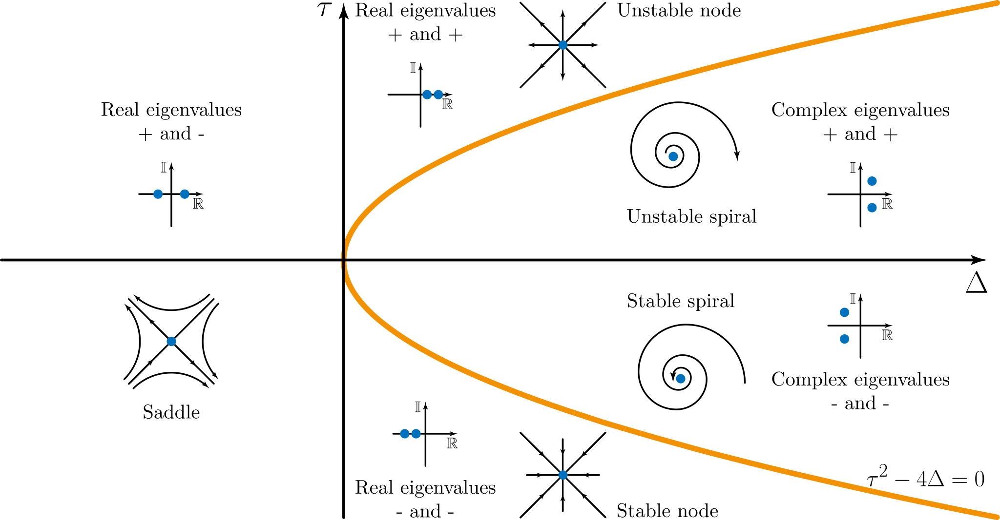

---

# Recap from previous parts

- 2-D linear systems can be solved analytically
- Eigenvalues are important
- Some larger systems can be simplified
- Phase planes, nullclines and fixed points

---
layout: two-cols
---

# Example from previous lecture

$$
\begin{aligned}
\dot{x} &= x(1-x) -xy,\\
\dot{y} &= y\left(2-y\right) - 3xy.
\end{aligned}
$$

::right::

<PlotFigure name="phase-plane" :height="440" />

---

# Linear ODEs for understanding nonlinear

The decoupled ODE system

$$
\begin{aligned}
\dot{x} = \frac{dx}{dt} &= \lambda_1 x,\\
\dot{y} = \frac{dy}{dt} &= \lambda_2 y,
\end{aligned}
$$

has a **fixed point** or **steady state** where $\dot{x}=\dot{y}=0$, at the origin.

Solutions look like $x=Ae^{\lambda_1 t}$ and $y=Be^{\lambda_2 t}$ and thus grow exponentially or shrink exponentially depending on the values of $\lambda_1$ and $\lambda_2$.

If $\lambda_1 < 0$ and $\lambda_2 < 0$ then all the flow is towards the fixed point.
If $\lambda_1$ or $\lambda_2$ is positive then some flow will be driven away (towards infinity).

---

# Linear ODEs: shifting the fixed point

Adding in a constant (inhomogeneous) component shifts the fixed point away from the origin.
Where is the fixed point of

$$
\begin{aligned}
\dot{x} &= \lambda_1 x + 10,\\
\dot{y} &= \lambda_2 y + 10?
\end{aligned}
$$

---

# Linear ODEs: coupling

Coupling the system has the effect of altering the principle directions over which the exponential terms apply (**changing the basis**).

This means that the **homogeneous** linear system

$$
\begin{aligned}
\dot{x} &= a x + b y,\\
\dot{y} &= c x + d y,
\end{aligned}
$$

has a fixed point at the origin.
The long-term growth or shrinkage of solutions over time is determined by the eigenvalues of the matrix

$$
A = \left(
\begin{array}{cc} a & b \\ c & d \end{array}
\right).
$$

---

# Linear ODEs: inhomogeneous systems

More generally, the **inhomogeneous** linear system

$$
\begin{aligned}
\dot{x} &= a x + b y + p,\\
\dot{y} &= c x + d y + q,
\end{aligned}
$$

can be written

$$
\left(\begin{array}{c} \dot{x} \\ \dot{y} \end{array}\right)
=
\left(\begin{array}{cc} a & b \\ c & d \end{array}\right)
\left(\begin{array}{c} x \\ y \end{array}\right)
+
\left(\begin{array}{c} p \\ q \end{array}\right).
$$

<v-click>

It has a fixed point at

$$
\left(\begin{array}{c} x \\ y \end{array}\right)
=
-\left(\begin{array}{cc} a & b \\ c & d \end{array}\right)^{-1}
\left(\begin{array}{c} p \\ q \end{array}\right).
$$

The long-term growth or shrinkage of solutions over time is again determined by the eigenvalues of the matrix.

</v-click>

---

# General nonlinear system steady states

A more general two-dimensional nonlinear system is

$$
\begin{aligned}
\dot{x} &= f(x,y),\\
\dot{y} &= g(x,y),
\end{aligned}
$$

where $f$ and $g$ can be any functions whatever.

<v-click>

We can write a polynomial (Taylor) expansion for the system when it is close to a fixed point $(x^*, y^*)$ for which $f(x^*,y^*)=g(x^*,y^*)=0$:

$$
\begin{aligned}
\dot{x} &= f(x^*,y^*) + \frac{\partial f}{\partial x}(x-x^*) + \frac{\partial f}{\partial y}(y-y^*) + \ldots,\\
\dot{y} &= g(x^*,y^*) + \frac{\partial g}{\partial x}(x-x^*) + \frac{\partial g}{\partial y}(y-y^*) + \ldots
\end{aligned}
$$

</v-click>

---

# General nonlinear system: linearisation

So, close to the fixed point:

$$
\def\arraystretch{1.8}\left(\begin{array}{c} \dot{x} \\ \dot{y} \end{array}\right)
\approx
\left(\begin{array}{cc} \frac{\partial f}{\partial x} & \frac{\partial f}{\partial y} \\ \frac{\partial g}{\partial x} & \frac{\partial g}{\partial y} \end{array}\right)
\left(\begin{array}{c} x-x^* \\ y-y^* \end{array}\right).
$$

This means that (really close to the fixed point) we can approximate with a linear system.
The eigenvalues $\lambda_1$, $\lambda_2$ of the matrix

$$
\def\arraystretch{1.8}J = \left(\begin{array}{cc} \frac{\partial f}{\partial x} & \frac{\partial f}{\partial y} \\ \frac{\partial g}{\partial x} & \frac{\partial g}{\partial y} \end{array}\right)
$$

will determine if a small perturbation away from $(x^*, y^*)$ will decay or grow.

---

# Steady state classification

$$
\def\arraystretch{1.8}J = \left(\begin{array}{cc} \frac{\partial f}{\partial x} & \frac{\partial f}{\partial y} \\ \frac{\partial g}{\partial x} & \frac{\partial g}{\partial y} \end{array}\right)
$$

- $\lambda_1<\lambda_2<0$: stable node
- $\lambda_1=\lambda_2<0$: stable star
- $\lambda_1>\lambda_2>0$: unstable node
- $\lambda_1=\lambda_2>0$: unstable star
- $\lambda_1<0<\lambda_2$: saddle (or hyperbolic) point, unstable
- Complex $\lambda$: spiral (with real part determining stability)
- Imaginary $\lambda$: neutral (solution cycles round fixed point)

The presence of negative eigenvalues determines whether a steady state is physically viable.

---

# Steady state classification: eigenvalues of J

$$
\def\arraystretch{1.8}|J-\lambda I| = \left|
\begin{array}{cc} \frac{\partial f}{\partial x}-\lambda & \frac{\partial f}{\partial y} \\ \frac{\partial g}{\partial x} & \frac{\partial g}{\partial y}-\lambda \end{array}\right|
= \left(\frac{\partial f}{\partial x}-\lambda\right)\left(\frac{\partial g}{\partial y}-\lambda\right)-\frac{\partial f}{\partial y}\frac{\partial g}{\partial x}
$$

So eigenvalues $\lambda$ satisfy

$$
\lambda^2 - \lambda\left(\frac{\partial f}{\partial x} + \frac{\partial g}{\partial y}\right) + \frac{\partial f}{\partial x}\frac{\partial g}{\partial y} - \frac{\partial f}{\partial y}\frac{\partial g}{\partial x},
$$

or

$$
\lambda^2 - \lambda\tau + \Delta \quad \text{where} \quad \tau=\text{Trace}(J) \quad \text{and} \quad \Delta = \text{Det}(J)
$$

---

# Steady state classification: trace and determinant

---

# Example system

$$
\begin{aligned}
\dot{x} &= x(1-x) -xy &&= f(x),\\
\dot{y} &= y\left(2-y\right) - 3xy &&= g(x).
\end{aligned}
$$

<v-clicks>

- What are the nullclines?
- What are the fixed points?
- What is the stability of the fixed points?

</v-clicks>

---

# Example system: Jacobian at (0, 0)

$$
\def\arraystretch{1.8}J = \left(\begin{array}{cc} \frac{\partial f}{\partial x} & \frac{\partial f}{\partial y} \\ \frac{\partial g}{\partial x} & \frac{\partial g}{\partial y} \end{array}\right) = \left(\begin{array}{cc} -2x-y+1 & -x \\ -3y & -3x-2y+2 \end{array}\right)
$$

<v-click>

At $(0,0)$:

$$
J_{(0,0)} = \left(\begin{array}{cc} 1 & 0 \\ 0 & 2 \end{array}\right)
$$

</v-click>

<v-click>

$$
\left|\begin{array}{cc} 1-\lambda & 0 \\ 0 & 2-\lambda\end{array}\right|\quad\implies\quad\lambda_1 = 1, \quad \lambda_2 = 2 \qquad\text{(unstable)}
$$

</v-click>

---

# Example system: Jacobian at (1/2, 1/2)

$$
\def\arraystretch{1.8}J = \left(\begin{array}{cc} \frac{\partial f}{\partial x} & \frac{\partial f}{\partial y} \\ \frac{\partial g}{\partial x} & \frac{\partial g}{\partial y} \end{array}\right) = \left(\begin{array}{cc} -2x-y+1 & -x \\ -3y & -3x-2y+2 \end{array}\right)
$$

<v-click>

At $(1/2,1/2)$:

$$
\def\arraystretch{1.8}J_{(1/2,1/2)} = \left(\begin{array}{cc} -\frac{1}{2} & -\frac{1}{2} \\ -\frac{3}{2} & -\frac{1}{2} \end{array}\right)
$$

</v-click>

<v-click>

$$
\def\arraystretch{1.8}\left|\begin{array}{cc} -\frac{1}{2}-\lambda & -\frac{1}{2} \\ -\frac{3}{2} & -\frac{1}{2}-\lambda\end{array}\right|\quad\implies\quad\lambda_\pm = \frac{1}{2} \pm \frac{\sqrt{3}}{2} \qquad\text{(saddle)}
$$

</v-click>

---

# Example system: Jacobian at (1, 0)

$$
\def\arraystretch{1.8}J = \left(\begin{array}{cc} \frac{\partial f}{\partial x} & \frac{\partial f}{\partial y} \\ \frac{\partial g}{\partial x} & \frac{\partial g}{\partial y} \end{array}\right) = \left(\begin{array}{cc} -2x-y+1 & -x \\ -3y & -3x-2y+2 \end{array}\right)
$$

<v-click>

At $(1,0)$:

$$
J_{(1,0)} = \left(\begin{array}{cc} -1 & -1 \\ 0 & -1 \end{array}\right)
$$

</v-click>

<v-click>

$$
\left|\begin{array}{cc} -1-\lambda & -1 \\ 0 & -1-\lambda\end{array}\right|\quad\implies\quad\lambda_1 = \lambda_2 = -1 \qquad\text{(stable)}
$$

</v-click>

---

# Example system: Jacobian at (0, 2)

$$
\def\arraystretch{1.8}J = \left(\begin{array}{cc} \frac{\partial f}{\partial x} & \frac{\partial f}{\partial y} \\ \frac{\partial g}{\partial x} & \frac{\partial g}{\partial y} \end{array}\right) = \left(\begin{array}{cc} -2x-y+1 & -x \\ -3y & -3x-2y+2 \end{array}\right)
$$

<v-click>

At $(0,2)$:

$$
J_{(0,2)} = \left(\begin{array}{cc} -1 & 0 \\ -6 & -2 \end{array}\right)
$$

</v-click>

<v-click>

$$
\left|\begin{array}{cc} -1-\lambda & 0 \\ -6 & -2-\lambda\end{array}\right|\quad\implies\quad\lambda_1 = -1, \quad \lambda_2 = -2 \qquad\text{(stable)}
$$

</v-click>

---

# Example system: phase plane

<PlotFigure name="phase-plane" :height="440" :max-width="460" />

---

# Summary

- Eigenvalues for behaviour of linear systems
- Eigenvalues for the stability of nonlinear systems
